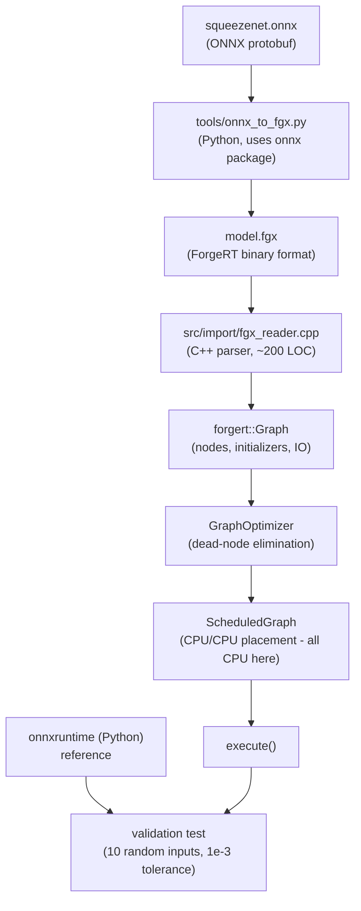

# Phase 8 Completion — Technical Design

## Overview

Complete the small operator set required to run SqueezeNet 1.1 end-to-end on CPU,
and design (not implement) a minimal ONNX importer that will follow.

Three operators are missing from the verified graph: AveragePool, Dropout, Reshape.
No other operators are required — the SqueezeNet 1.1 graph uses exactly 7 op types
(Conv, Relu, Concat, MaxPool, Dropout, AveragePool, Reshape); the first four are
already implemented and tested.

This design covers:
- **Part A:** Implementation of AveragePool2DOp, DropoutOp, ReshapeOp with CPU backends
- **Part B:** Verified enumeration of every operator, attribute, initializer, and
  data type in the actual SqueezeNet 1.1 ONNX graph (re-inspected directly, not
  from a summary)
- **Part C:** Design of a minimal ONNX importer (no implementation in this phase)

The design is design-first because the operator approach follows established
ForgeRT patterns (Conv2D, Concat, MaxPool2D) and the importer is the main
unknown requiring architectural decisions.

## Part B — Verified SqueezeNet 1.1 Requirements

Re-inspected the ONNX graph directly (`models/squeezenet1.1-7.onnx`, opset 7):

| Operator | Count | Attributes (from actual graph) | ForgeRT status |
|---|---|---|---|
| Conv | 26 | kernel 1x1/3x3, stride 1/2, pad 0/1, group 1, dilation 1 | Done |
| Relu | 26 | (none) | Done |
| Concat | 8 | axis=1, exactly 2 inputs | Done |
| MaxPool | 3 | kernel=[3,3], stride=[2,2], pads=[0,0,0,0] | Done |
| Dropout | 1 | ratio=0.5 (opset 7; no training_mode) | **Missing** |
| AveragePool | 1 | kernel=[13,13], stride=[13,13], pads=[0,0,0,0] | **Missing** |
| Reshape | 1 | shape tensor = `[0, -1]` (ONNX wildcards) | **Missing** |

**No other operations are needed.** The graph does not use Flatten,
GlobalAveragePool, Transpose, Gemm, or any shape ops beyond Reshape.

### Data types and layouts

- All operator inputs/outputs: float32 (ONNX elem_type=1)
- One int64 initializer: `reshape_attr_tensor118` (elem_type=7, dims=[2], values=[0,-1])
- All activations are 4-D NCHW: `[N, C, H, W]` row-major
- Graph input: `data` [1, 3, 224, 224] float32
- Graph output: `squeezenet0_flatten0_reshape0` [1, 1000] float32

### Initializers

- 52 float32 weight/bias tensors (4.71 MB total)
- 1 int64 reshape shape tensor (16 bytes)
- Total: 4.95 MB model file

### Output path (last 5 nodes, verified)

```
Concat(7) -> Dropout -> Conv(25) -> Relu(25) -> AveragePool -> Reshape -> output
```

The Dropout sits between the final Concat and the classifier Conv. At inference
it is identity; the `ratio=0.5` attribute is ignored (ONNX spec: Dropout at
inference passes input through unchanged).

### Reshape wildcard semantics

The shape tensor is `[0, -1]`, not `[1, 1000]`. ONNX Reshape rules:
- `0` = copy the dimension from the input
- `-1` = infer this dimension from the remaining elements

For input `[1, 1000, 1, 1]` with shape `[0, -1]`:
- dim 0 = 0 -> copy input dim 0 = 1
- dim 1 = -1 -> total_elements / 1 = 1000
- result: `[1, 1000]`

The Reshape operator must read the input shape at execute time and resolve
wildcards. It cannot bake the output shape at construction time.

## Architecture



The importer is a separate build target (`forgert_import` library) so the core
runtime stays dependency-free. The validation test is a separate executable
that links both ForgeRT and (via Python or precomputed files) the ONNX Runtime
reference outputs.

### Operator architecture (all three new operators)

Follow the existing operator contract established by Conv2D/Concat/MaxPool2D:
- Header in `include/forgert/operator/`
- Inherit from `Operator`, implement `name()`, `clone()`, `supportsBackend()`,
  `inferOutputShapes()`, `executeCPU()`
- Use `validateDevice`, `validateDtype`, `validateInputCount` helpers
- CPU-only: no CUDA backend (justified per operator below)
- Added to `include/forgert/forgert.h` umbrella header
- One test file per operator in `tests/`
- Registered in `tests/CMakeLists.txt` and `add_test()` for CTest

## Components and Interfaces

### 1. AveragePool2DOp

**File:** `include/forgert/operator/averagepool2d.h`

```cpp
struct AvgPool2DParams {
    int kH = 1, kW = 1;
    int stride_h = 1, stride_w = 1;
    int pad_h = 0, pad_w = 0;
    // count_include_pad: ONNX default is 0 (SqueezeNet uses pads=0 so
    // irrelevant, but support the semantic for correctness)
    bool count_include_pad = false;
};

class AvgPool2DOp : public Operator {
public:
    explicit AvgPool2DOp(AvgPool2DParams p = {});
    std::string name() const override;        // "AveragePool2D"
    std::unique_ptr<Operator> clone() const override;
    bool supportsBackend(Backend) const override;  // CPU only
    std::vector<TensorShape> inferOutputShapes(...) const override;
    void executeCPU(...) override;
};
```

**Shape inference:** identical to MaxPool2DOp:
```
H_out = floor((H_in + 2*pad_h - kH) / stride_h) + 1
W_out = floor((W_in + 2*pad_w - kW) / stride_w) + 1
output: [N, C, H_out, W_out]
```

**CPU execution:** direct sliding-window mean reduction.
```
for each (n, c, oh, ow):
    sum = 0
    count = 0
    for each (kh, kw) in kernel:
        ih = oh*stride_h - pad_h + kh
        iw = ow*stride_w - pad_w + kw
        if 0 <= ih < H_in and 0 <= iw < W_in:
            sum += input[n,c,ih,iw]
            count += 1
    output[n,c,oh,ow] = sum / count   (count_include_pad=false)
                    or sum / (kH*kW)  (count_include_pad=true)
```

**SqueezeNet scope:** kernel=13, stride=13, pad=0 — the single AveragePool node
is effectively global average pooling on a 13x13 input, producing [1, C, 1, 1].

**No CUDA backend:** for 13x13x13x13 reduction on a 1000-channel input, the
work is ~170K MACs. GPU launch overhead (20 us) exceeds the compute time.
CPU completes in <1 ms.

### 2. DropoutOp

**File:** `include/forgert/operator/dropout.h`

```cpp
struct DropoutParams {
    float ratio = 0.5f;  // ignored at inference; stored for completeness
    // training_mode is opset 12+; SqueezeNet uses opset 7 with no attribute
};

class DropoutOp : public Operator {
public:
    explicit DropoutOp(DropoutParams p = {});
    std::string name() const override;        // "Dropout"
    std::unique_ptr<Operator> clone() const override;
    bool supportsBackend(Backend) const override;  // CPU only
    std::vector<TensorShape> inferOutputShapes(...) const override;  // identity
    void executeCPU(...) override;            // memcpy
};
```

**Shape inference:** output shape == input shape (identity).

**CPU execution:** `memcpy(output, input, numBytes)`. At inference, Dropout is
always identity regardless of `ratio`. The operator does not generate a mask
and does not scale the output.

**ONNX attribute handling:**
- `ratio` (float): stored in params, never used at inference
- `training_mode` (int, opset 12+): not present in SqueezeNet opset 7
- If a future model sets `training_mode=1`, the importer must error — ForgeRT
  does not execute training mode

**No CUDA backend:** identity copy. A CUDA kernel would add 20 us launch
overhead for zero compute benefit.

### 3. ReshapeOp

**File:** `include/forgert/operator/reshape.h`

```cpp
class ReshapeOp : public Operator {
public:
    // No params — the target shape is the second input tensor
    std::string name() const override;        // "Reshape"
    std::unique_ptr<Operator> clone() const override;
    bool supportsBackend(Backend) const override;  // CPU only
    std::vector<TensorShape> inferOutputShapes(...) const override;
    void executeCPU(...) override;
};
```

**Inputs:** `[0]` data tensor (float32), `[1]` shape tensor (int32)

**Shape inference:** reads the shape tensor's data at inference time. Because
ForgeRT's `Tensor` only supports Float32 and Int32 today (see
`include/forgert/tensor/dtype.h`), and the ONNX shape tensor is int64, the
importer must convert int64 -> int32 when loading initializers. This is safe
for SqueezeNet (shape values are 0 and -1) but the operator should document
the int32 limit (max ~2B elements — fine for any realistic model).

**Wildcard resolution at execute time:**
```
target_dims = shape_tensor[1].data()  // int32 array
resolved_dims = []
unknown_dim_idx = -1
running_product = 1
for i, d in target_dims:
    if d == 0:
        resolved_dims[i] = input.dim(i)
        running_product *= input.dim(i)
    elif d == -1:
        unknown_dim_idx = i
    else:
        resolved_dims[i] = d
        running_product *= d
if unknown_dim_idx >= 0:
    resolved_dims[unknown_dim_idx] = input.numElements() / running_product
```

**CPU execution:** `memcpy`. The data layout is row-major and unchanged —
reshape only reinterprets the shape metadata. The operator copies the bytes
into the output tensor (which has the resolved shape).

**Zero-copy view investigation:**
ForgeRT's `Tensor` class (`include/forgert/tensor/tensor.h`) owns its memory
via `data_` (a `void*` allocated in the constructor, freed in the destructor).
There is no "view" or "non-owning" mode exposed to operators — the constructor
takes `(shape, dtype, device)` and always allocates. Adding a view mode would
require:
- New constructor: `Tensor(Tensor::view, Tensor& src, TensorShape new_shape)`
- New `owns_memory_` flag (already exists for the external-memory case)
- Lifetime tracking so the view doesn't outlive the source

**Decision:** implement Reshape as a memcpy for now. The cost for SqueezeNet
is one copy of [1, 1000] = 4000 bytes, negligible vs the ~1 ms classifier Conv.
Add a note in the operator header that a zero-copy view is a future
optimization requiring Tensor API changes. Do not change the Tensor API in
this phase.

**No CUDA backend:** memcpy of small tensors; launch overhead dominates.

### Importer components (Part C, design only)

**`tools/onnx_to_fgx.py`** — Python script using the `onnx` package to read
any ONNX model and emit a `.fgx` file in a trivial binary format.

**`src/import/fgx_reader.cpp`** — C++ reader (~200 LOC) that parses `.fgx`
and builds a `forgert::Graph`. No protobuf dependency at runtime.

**`tests/test_squeezenet_e2e.cpp`** — end-to-end test that loads SqueezeNet,
runs 10 random inputs, compares against precomputed ONNX Runtime outputs.

## Data Models

### `.fgx` binary format

```
Magic: "FGX1" (4 bytes)
Section: GRAPH
  num_inputs (u32)
  for each input: name_len (u32), name (bytes), ndim (u32), dims (u64[])
  num_outputs (u32)
  for each output: name_len (u32), name (bytes), ndim (u32), dims (u64[])
  num_nodes (u32)
  for each node:
    op_type_len (u32), op_type (bytes)
    num_inputs (u32), input_names (name_len + bytes each)
    num_outputs (u32), output_names (name_len + bytes each)
    num_attrs (u32)
    for each attr: name_len, name, type (u8), value (type-dependent)
Section: INITIALIZERS
  num_inits (u32)
  for each init:
    name_len (u32), name (bytes)
    ndim (u32), dims (u64[])
    dtype (u32)  // 1=float32, 7=int64
    num_bytes (u64), data (bytes)
```

### ONNX -> ForgeRT operator mapping

| ONNX op | ForgeRT class | Attribute extraction |
|---|---|---|
| Conv | Conv2DOp | kernel_shape, strides, pads -> Conv2DParams; dilations/group validated = 1 |
| Relu | ReLUOp | (none) |
| Concat | ConcatOp | axis -> constructor arg |
| MaxPool | MaxPool2DOp | kernel_shape, strides, pads -> MaxPool2DParams |
| AveragePool | AvgPool2DOp | kernel_shape, strides, pads -> AvgPool2DParams; count_include_pad (default 0) |
| Dropout | DropoutOp | ratio (stored, ignored at inference) |
| Reshape | ReshapeOp | (shape is second input tensor) |

### Tensor name -> Graph node ID mapping

ForgeRT's `Graph` uses integer node IDs returned by `addInput` / `addNode`.
The importer maintains a `std::unordered_map<std::string, size_t>` from
ONNX tensor names to ForgeRT node IDs.

- ONNX graph inputs (excluding initializers) -> `graph.addInput()`
- ONNX initializers -> loaded into `Tensor` objects, attached as constant
  inputs to the nodes that consume them
- ONNX nodes -> `graph.addNode()` with input IDs looked up from the map
- ONNX graph outputs -> `graph.markOutput()`

### Initializer handling

- Float32 initializers: load raw bytes directly into `Tensor(shape, Float32, CPU)`
- Int64 initializers: convert to int32 (with bounds check) and load into
  `Tensor(shape, Int32, CPU)`. The Reshape shape tensor is the only int64
  initializer in SqueezeNet and its values (0, -1) fit trivially.
- Initializers are passed as additional inputs to the consuming node's
  `execute()` call, matching how Conv2D already accepts weight + bias

## Correctness Properties

### Property 1: AveragePool2D mean correctness
**For all input tensors I and valid AvgPool2DParams P:**
- For each output element `o[n,c,oh,ow]`:
  - If `count_include_pad == false`: `o = sum(I[n,c,ih,iw] for valid (ih,iw) in window) / count_valid`
  - If `count_include_pad == true`:  `o = sum(I[n,c,ih,iw] for valid (ih,iw) in window) / (kH*kW)`
- `H_out = floor((H_in + 2*pad_h - kH) / stride_h) + 1` (ONNX floor-mode, no ceil_mode)

### Property 2: Dropout inference identity
**For all input tensors I at inference:**
- `output[i] == input[i]` for all i (byte-identical memcpy)
- The `ratio` attribute has no effect on the inference output
- No mask is generated; no scaling by `1/(1-ratio)` is applied
- If the importer encounters `training_mode=1`, it must error (ForgeRT is inference-only)

### Property 3: Reshape element count preservation
**For all input tensors I and shape tensors S:**
- `output.numElements() == input.numElements()` (total element count preserved)
- Wildcard `0` in S copies the corresponding input dimension: `out_dim[i] = in_dim[i]`
- Wildcard `-1` in S is resolved so the total product equals input numElements:
  `out_dim[k] = input.numElements() / product(out_dim[i] for i != k)`
- At most one `-1` per shape (ONNX constraint, enforced by shape inference)
- Data bytes are unchanged (memcpy preserves the bit pattern)

### Property 4: Importer node mapping completeness
**For every ONNX node N in the input model:**
- N maps to exactly one ForgeRT operator instance
- All of N's inputs are resolved to ForgeRT node IDs via the name map
- If `N.op_type` is not in the supported set, the importer fails fast with a
  message listing the offending node index and the supported op set

### Property 5: Initializer byte fidelity
**For every ONNX initializer `init`:**
- The ForgeRT Tensor's byte count equals `len(init.raw_data)`
- For float32 initializers: bytes are copied verbatim
- For int64 initializers: each value is converted to int32 with a bounds check;
  conversion fails if any value exceeds `INT32_MAX` or is below `INT32_MIN`

### Property 6: Shape validation against ONNX value_info
**For every ONNX node with a `value_info` entry for its outputs:**
- `ForgeRT::inferOutputShapes()` must produce a shape matching the ONNX value_info
- Mismatch is an importer error (indicates a parsing or attribute-extraction bug)

### Property 7: End-to-end numerical equivalence
**For SqueezeNet 1.1 and 10 random inputs `x_i ~ N(0,1)` of shape [1,3,224,224]:**
- `max |ForgeRT(x_i) - ONNXRuntime(x_i)| < 1e-3` for each i
- `argmax(ForgeRT(x_i)) == argmax(ONNXRuntime(x_i))` for each i
  (predicted class matches)

## Error Handling

### Operator-level errors (thrown as `std::invalid_argument`)
- Wrong input count (validateInputCount)
- Wrong device (validateDevice — CPU expected)
- Wrong dtype (validateDtype — Float32 expected)
- Wrong input rank (AveragePool requires 4-D)
- Reshape: shape product != input numElements
- Reshape: more than one `-1` in shape
- Reshape: `0` dim with no matching input dim (input dim doesn't exist)

### Importer-level errors (fail fast, clear message)
- Unsupported operator: list supported ops, point at the offending node
- `training_mode=1` on Dropout: "ForgeRT does not execute training mode"
- int64 initializer value > INT32_MAX: "int64 value overflow on conversion to int32"
- ONNX value_info mismatch with inferOutputShapes: importer bug, report both shapes
- `.fgx` magic/version mismatch: "incompatible .fgx file"

No silent CPU fallback, no partial graph execution. The user must know
exactly which op is missing and where.

## Testing Strategy

### Operator unit tests (one file per operator)

**`tests/test_averagepool2d.cpp`:**
- SqueezeNet shape: [1,1000,13,13] 13x13/s13 -> [1,1000,1,1]
- Known values: 2x2 average on 4x4 input, hand-verifiable
- count_include_pad=true vs false with padding > 0
- Multi-channel, multi-batch independence
- Output size formula: 4 configs
- Error cases: 3-D input, wrong input count

**`tests/test_dropout.cpp`:**
- Identity: output == input byte-for-byte
- Various shapes (1D, 2D, 4D)
- Non-trivial values (random data) to ensure no zeroing or scaling
- Error cases: wrong input count, wrong output count, shape mismatch

**`tests/test_reshape.cpp`:**
- SqueezeNet case: [1,1000,1,1] + shape [0,-1] -> [1,1000]
- Wildcard 0: [2,3,4] + shape [0,2,6] -> [2,2,6]
- Wildcard -1: [2,3,4] + shape [2,-1] -> [2,12]
- Both wildcards: [2,3,4] + shape [0,-1] -> [2,12]
- Literal shape: [6] + shape [2,3] -> [2,3]
- Error: total elements mismatch
- Error: multiple -1 in shape
- Error: 0 dim with no matching input dim
- Error: wrong input count

### End-to-end validation (Part C, separate phase)

**Reference runtime:** ONNX Runtime CPU (Python `onnxruntime` package).

**Test protocol:**
1. Load SqueezeNet via ONNX Runtime
2. Generate 10 random inputs [1,3,224,224] ~N(0,1)
3. Run ONNX Runtime, save outputs (1000-class logits)
4. Load the same model via ForgeRT importer, run the same inputs
5. Compare outputs: `max |forgeRT_out - onnxrt_out|` < 1e-3
6. Report: per-sample max diff, mean diff, argmax (predicted class) match

**Tolerance justification:** 1e-3 is conservative for float32 through 66
nodes. Conv2D CPU uses naive accumulation (no BLAS), so some drift is
expected. If diff exceeds 1e-3, investigate per-operator.

**What NOT to compare:**
- Wall-clock latency (ForgeRT CPU Conv2D is naive; ONNX Runtime uses
  optimized BLAS — not a fair comparison and not the goal of Phase 8)
- Memory usage (different allocators)
- Throughput

The validation is about **numerical correctness**, not performance.
Performance comparison is Phase 9.

## Parsing Strategy — Dependency Evaluation

| Option | Pros | Cons |
|---|---|---|
| Custom protobuf reader in C++ | No dependencies | ~500 LOC, must track ONNX proto schema changes, high maintenance, easy to get varint/zigzag wrong |
| `onnx` C++ library (libonnx) | Spec-compliant | ~5 MB dependency, requires protobuf, heavy for an educational runtime |
| `onnxruntime` parser | Battle-tested | Pulls in entire inference runtime; defeats the purpose of building ForgeRT |
| **Build-time Python + custom C++ reader** | No runtime dep, Python already in the toolchain, simple C++ reader | Requires Python at build time (already needed for MNIST training) |

**Decision: use the `onnx` Python package at build time to generate a
ForgeRT-native intermediate format (`.fgx`), and write a minimal C++ parser
for that format. Do not link against onnx C++ library or onnxruntime.**

This splits the problem:
1. A Python script (`tools/onnx_to_fgx.py`) uses the already-installed `onnx`
   package to read the model and emit a ForgeRT-native `.fgx` file with a
   trivial binary format.
2. A small C++ reader (`src/import/fgx_reader.cpp`, ~200 LOC) parses `.fgx`
   and builds a `forgert::Graph`.

This avoids the protobuf complexity in C++ while keeping the runtime
dependency-free. The Python tool runs once per model; the C++ reader is
simple enough to audit by hand.

**Fallback:** if the Python-at-build-time requirement is unacceptable for
some deployment, the C++ reader can be extended to parse ONNX protobuf
directly later. The `.fgx` format is a stepping stone, not a lock-in.

**Dependencies added:** none at runtime. Python `onnx` and `onnxruntime`
(both already installed) are build-time/test-time only.

## Risks

| Risk | Likelihood | Impact | Mitigation |
|---|---|---|---|
| Reshape wildcard semantics wrong | Medium | High | Unit tests with all wildcard combos; compare to ONNX Runtime |
| AveragePool count_include_pad bug | Low | Medium | SqueezeNet uses pad=0 so irrelevant; still tested for correctness |
| Dropout training mode slips in | Low | High | Importer errors if `training_mode=1`; Dropout ignores ratio at inference |
| int64 -> int32 initializer overflow | Very Low | High | Bounds check in importer; fail if any int64 value > INT32_MAX |
| ONNX value_info missing for some nodes | Medium | Low | Fall back to inferOutputShapes; log a warning |
| Conv2D numerical drift over 26 layers | Medium | High | Per-layer validation against ONNX Runtime; tolerance 1e-3 |
| `.fgx` format versioning | Low | Low | Magic + version field; reject mismatched versions |

## Acceptance Criteria

Part A is complete when:
- [ ] AveragePool2DOp, DropoutOp, ReshapeOp implemented with CPU backend
- [ ] Each operator has a focused test file; all tests pass
- [ ] 27+ tests pass (24 existing + 3 new test files)
- [ ] Operators added to `forgert.h` umbrella header
- [ ] CPU-only build path preserved (no new CUDA requirements)

Part C (importer) is complete when:
- [ ] `tools/onnx_to_fgx.py` converts SqueezeNet to `.fgx`
- [ ] `src/import/fgx_reader.cpp` loads `.fgx` into a `forgert::Graph`
- [ ] All 66 nodes mapped; all 53 initializers loaded
- [ ] `test_squeezenet_e2e.cpp` runs the full graph on 10 random inputs
- [ ] Max diff vs ONNX Runtime < 1e-3 on all 10 inputs
- [ ] Predicted class (argmax) matches ONNX Runtime on all 10 inputs

**SqueezeNet compatibility is NOT claimed until the end-to-end validation
passes.** This design covers Parts A and C; Part C is design only in this
phase — no importer implementation yet.

## Out of Scope

- Direct ONNX protobuf parsing in C++ (deferred)
- Dynamic shapes (SqueezeNet is static)
- Control flow (Loop, If)
- Subgraphs
- Quantization
- Custom operators
- Multi-GPU
- LLM/Ollama integration
- Performance benchmarking vs ONNX Runtime (Phase 9)

## Implementation Order (next phases)

1. Implement AveragePool2DOp + tests (smallest, unblocks SqueezeNet output path)
2. Implement DropoutOp + tests (trivial, identity)
3. Implement ReshapeOp + tests (wildcard semantics need care)
4. Run full regression suite
5. Commit and push
6. (Separate phase) Implement `.fgx` converter + reader
7. (Separate phase) End-to-end SqueezeNet validation