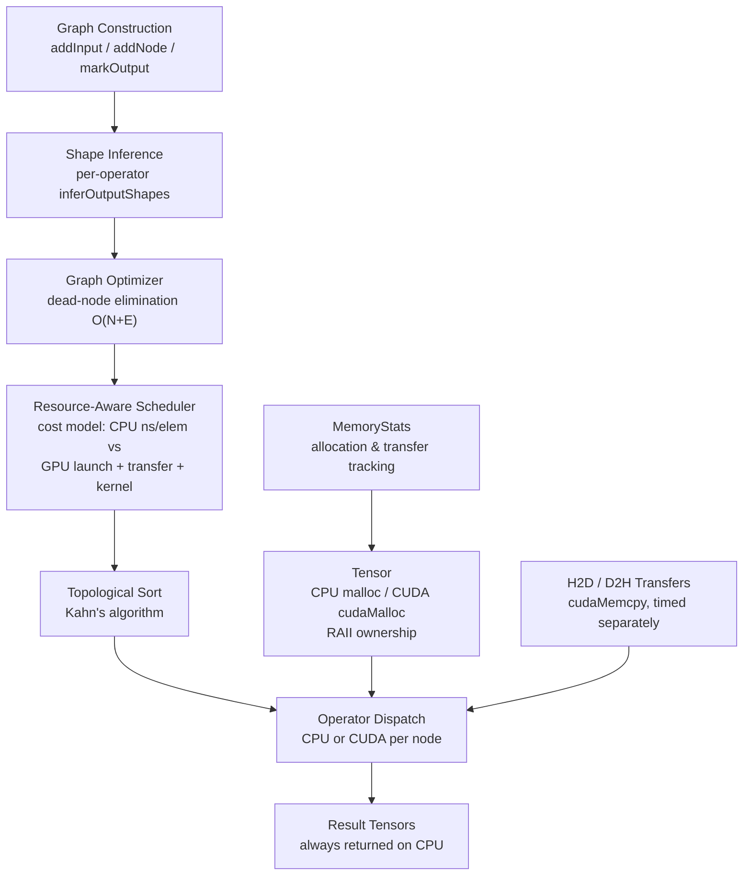

# ForgeRT

**Resource-Aware Neural Inference Runtime**

ForgeRT is an educational C++17 / CUDA inference runtime demonstrating
cost-model–based CPU/GPU operator placement. Each operator is dispatched
to whichever device the scheduler estimates will finish first — factoring
in PCIe transfer overhead, kernel launch latency, and VRAM budget — rather
than blindly offloading everything to the GPU.

> **Status — Phase 8 in progress.**
> 7 operators implemented (5 with CUDA). 24 tests pass.
> SqueezeNet 1.1 inference is the current milestone;
> the ONNX importer is not yet built.

---

## Architecture



The scheduler is a **pure function** of operator profiles + device context.
It has no GPU dependency and is unit-testable without hardware.

---

## Operators

### CPU backend

| Operator    | Description                              | Layout        | Status    |
|-------------|------------------------------------------|---------------|-----------|
| **Add**     | Element-wise addition with broadcasting  | any           | ✅ Tested |
| **ReLU**    | Rectified linear unit                    | any           | ✅ Tested |
| **MatMul**  | 2-D matrix multiplication                | `[M,K]@[K,N]` | ✅ Tested |
| **Softmax** | Numerically stable, last dimension       | `[B,C]`       | ✅ Tested |
| **LayerNorm** | Two-pass mean+variance, last dim       | `[B,F]`       | ✅ Tested |
| **Conv2D**  | Direct conv, optional bias, NCHW         | `[N,C,H,W]`   | ✅ Tested |
| **Concat**  | Axis concatenation, N≥2 inputs           | `[N,C,H,W]`   | ✅ Tested |
| **MaxPool2D** | Sliding-window max, NCHW              | `[N,C,H,W]`   | ✅ Tested |

### CUDA backend

| Operator    | Kernel strategy              | Verified               |
|-------------|------------------------------|------------------------|
| **ReLU**    | Grid-stride loop             | ✅ `ReLUCUDATest`       |
| **MatMul**  | 16×16 tiled shared-memory    | ✅ `MatMulCUDATest`     |
| **Softmax** | Multi-pass reduction         | ✅ `SoftmaxCUDATest`    |
| **LayerNorm** | Dual-reduction (shared mem) | ✅ `LayerNormCUDATest`  |
| **Add**     | Element-wise with broadcast  | ✅ `AddCUDATest`        |
| **Conv2D**  | im2col + 16×16 tiled GEMM    | ✅ `Conv2DCUDATest`     |

Concat and MaxPool2D are CPU-only by design: for SqueezeNet's spatial sizes,
PCIe transfer cost + 20 µs launch overhead exceeds any compute saving.

---

## Benchmark

Measured on **GTX 1050 (sm\_61) / i5-9300H**, CUDA 12.6, MSVC 14.39 Release,
100 GPU iterations (CUDA events), 100 CPU iterations (chrono).


| Operator | Shape | CPU (ms) | GPU kernel (ms) | GPU E2E (ms) | CPU/E2E |
|---|---|---|---|---|---|
| ReLU | [1M] | 0.97 | 0.17 | 2.48 | 0.4× |
| Add | [1M] | 1.37 | 0.24 | 3.91 | 0.4× |
| Softmax | [512,1024] | 10.10 | 2.83 | 5.76 | 1.8× |
| LayerNorm | [512,768] | 3.94 | 0.15 | 1.86 | 2.1× |
| MatMul | [512×512] | 884.7 | 2.00 | 3.13 | 283× |

**E2E = H2D transfer + kernel + D2H transfer** using pre-allocated device tensors.
Kernel-only excludes transfer cost.
GPU launch overhead on GTX 1050: ~20 µs (measured with null-kernel benchmark).

> The scheduler chooses GPU for large MatMul (283× E2E speedup) and CPU for
> element-wise ops at these sizes (transfer dominates). This is the expected
> behavior: the runtime adapts, rather than blindly offloading.

Full methodology: [`docs/PHASE7_CALIBRATION.md`](docs/PHASE7_CALIBRATION.md)

---

## Quick Start

**Requirements:** MSVC 14.39, CUDA 12.6, CMake 3.18+, Ninja

```batch
REM Activate MSVC 14.39 environment first, then:
cmake -S . -B build -G Ninja -DCMAKE_BUILD_TYPE=Release
cmake --build build
ctest --test-dir build --output-on-failure
```

Or use the build script:

```batch
scripts\build.bat test
```

**Run the MNIST demo:**

```batch
cd models
python train_mnist.py          REM generates mnist_mlp.fgwt (once)
cd ..
build\examples\mnist\mnist_inference.exe models\mnist_mlp.fgwt models\mnist_test_samples.fgwt
```

Expected: 10/10 correct, confidence scores matching PyTorch to 4 decimal places.

---

## Test Results

All 24 tests verified on GTX 1050 / CUDA 12.6 / MSVC 14.39:

```
 1  TensorTest            PASS      7  LayerNormTest         PASS
 2  TensorCUDATest        PASS      8  Conv2DTest            PASS
 3  OperatorTest          PASS      9  ConcatTest            PASS
 4  ReLUTest              PASS     10  MaxPool2DTest         PASS
 5  MatMulTest            PASS     11  GraphTest             PASS
 6  SoftmaxTest           PASS     12  GraphMatMulTest       PASS

13  GraphSoftmaxTest      PASS     19  ReLUCUDATest          PASS
14  MemoryStatsTest       PASS     20  MatMulCUDATest        PASS
15  GraphOptimizerTest    PASS     21  SoftmaxCUDATest       PASS
16  SchedulerTest         PASS     22  LayerNormCUDATest     PASS
17  ReLUOpCUDATest        PASS     23  AddCUDATest           PASS
18  Conv2DCUDATest        PASS     24  LayerNormStressTest   PASS
```

---

## Project Layout

```
include/forgert/        Public headers (operators, graph, scheduler, tensor)
src/                    Core library (tensor, memory stats, optimizer, scheduler)
cuda/kernels/           CUDA kernel sources (.cu) + host launchers
tests/                  One test file per operator and subsystem
benchmarks/             CPU and CUDA benchmark harnesses
examples/mnist/         MNIST inference demo (trained 2-layer MLP)
models/                 Training script and model documentation
docs/                   Architecture notes, calibration reports, roadmap
  images/               Charts and diagrams (generated from real measurements)
scripts/                build.bat (Windows)
```

---

## Resource-Aware Scheduler

`SchedulingPolicy::decide()` estimates per-operator cost on each device:

```
cost_cpu = cpu_ns_per_elem × num_elements

cost_gpu = H2D_ns(input_bytes)            [0 if already resident on GPU]
         + launch_overhead_ns             [20 000 ns, measured GTX 1050]
         + (cpu_ns_per_elem / speedup) × num_elements
         + D2H_ns(output_bytes)

decision = argmin(cost_cpu, cost_gpu)
         subject to: cuda_supported AND vram_budget_ok
```

Measured profiles (i5-9300H / GTX 1050):

| Operator | CPU ns/elem | GPU speedup | Source |
|---|---|---|---|
| ReLU | 0.40 | 3× | Measured |
| Add | 0.60 | 4× | Measured |
| Softmax | 6.0 | 10× | Measured |
| LayerNorm | 2.4 | 4× | Measured |
| MatMul | 850 | 120× | Measured |
| Conv2D | 400 | 100× | Measured (range: 55–3200 by layer) |

Transfer bandwidth: 6 bytes/ns (PCIe 3.0). VRAM budget: 3.8 GB.

Full calibration details: [`docs/PHASE7_CALIBRATION.md`](docs/PHASE7_CALIBRATION.md)

---

## Limitations

- **Windows only** — Linux build is untested.
- **No ONNX importer yet** — model weights must be in the custom FGWT format.
- **SqueezeNet not yet verified** — AveragePool, Reshape, and Dropout still needed;
  end-to-end ONNX inference has not been validated against a reference runtime.
- **CPU-bound Conv2D** — the naive direct implementation is correct but slow;
  CUDA im2col+GEMM is implemented but not yet tested at full SqueezeNet scale.
- **No batching beyond N=1** — the graph engine supports N>1 but demos use N=1.
- **No FP16/INT8** — float32 only.

---

## Roadmap

| Phase | Milestone | Status |
|---|---|---|
| 1–3 | Tensor, operators, CUDA kernels | ✅ Done |
| 4 | Memory tracking | ✅ Done |
| 5 | Graph optimizer (dead-node elimination) | ✅ Done |
| 6 | Resource-aware scheduler | ✅ Done |
| 7 | CUDA test reliability + scheduler calibration | ✅ Done |
| 8 | Conv2D, Concat, MaxPool2D | ✅ Done |
| 8 | AveragePool + minimal ONNX importer | 🔄 Next |
| 8 | SqueezeNet end-to-end inference | 🔄 Next |
| 9 | Benchmarking vs ONNX Runtime | Planned |
| 10 | Visualisation and final report | Planned |

---

## Contributing

See [CONTRIBUTING.md](CONTRIBUTING.md) and [CODE_OF_CONDUCT.md](CODE_OF_CONDUCT.md).
Security: [SECURITY.md](SECURITY.md).

## License

MIT — see [LICENSE](LICENSE).

---

*"A GPU operation is not automatically better than a CPU operation."*