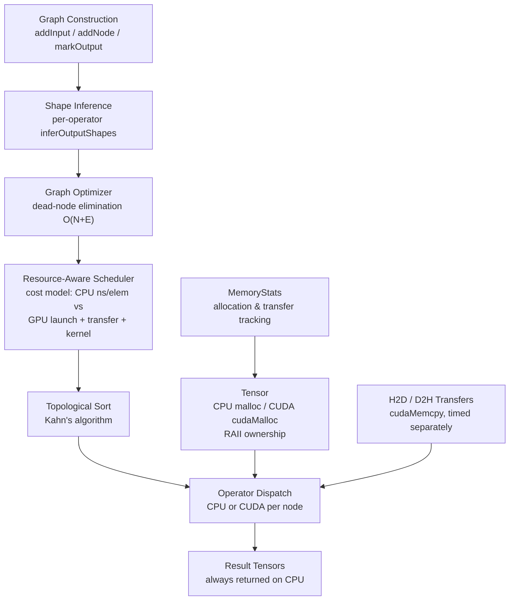
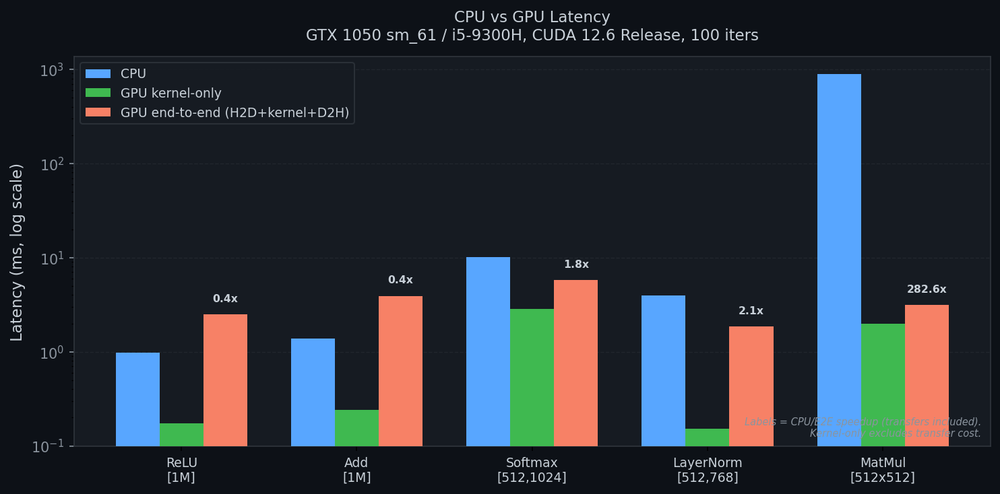

# ForgeRT

**Resource-Aware Neural Inference Runtime**

ForgeRT is an educational C++17 / CUDA inference runtime demonstrating
cost-model–based CPU/GPU operator placement. Each operator is dispatched
to whichever device the scheduler estimates will finish first — factoring
in PCIe transfer overhead, kernel launch latency, and VRAM budget — rather
than blindly offloading everything to the GPU.

> **Status: Phase 8 complete.**
> 11 operators (6 with CUDA). An ONNX opset 7 subset can be converted and run on CPU.
> SqueezeNet 1.1 matched ONNX Runtime on 10 seeded random inputs (max abs
> difference 5.7e-06, same argmax each time). CPU path validated against ONNX Runtime; mixed CPU/CUDA execution of the same imported graph is validated against the CPU result (max abs diff ~5e-06). Real-image accuracy,
> and other models are not validated.
> Details: [`docs/ONNX_IMPORT.md`](docs/ONNX_IMPORT.md).

---

## Architecture



The scheduler is a **pure function** of operator profiles + device context.
It has no GPU dependency and is unit-testable without hardware.

---

## Operators

### CPU backend

| Operator    | Description                              | Layout        | Status    |
|-------------|------------------------------------------|---------------|-----------|
| **Add**     | Element-wise addition with broadcasting  | any           | ✅ Tested |
| **ReLU**    | Rectified linear unit                    | any           | ✅ Tested |
| **MatMul**  | 2-D matrix multiplication                | `[M,K]@[K,N]` | ✅ Tested |
| **Softmax** | Numerically stable, last dimension       | `[B,C]`       | ✅ Tested |
| **LayerNorm** | Two-pass mean+variance, last dim       | `[B,F]`       | ✅ Tested |
| **Conv2D**  | Direct conv, optional bias, NCHW         | `[N,C,H,W]`   | ✅ Tested |
| **Concat**  | Axis concatenation, N≥2 inputs           | `[N,C,H,W]`   | ✅ Tested |
| **MaxPool2D** | Sliding-window max, NCHW              | `[N,C,H,W]`   | ✅ Tested |
| **AveragePool2D** | Sliding-window mean, `count_include_pad` | `[N,C,H,W]` | ✅ Tested |
| **Dropout** | Inference identity (no mask, no scaling) | any       | ✅ Tested |
| **Reshape** | ONNX `0` / `-1` wildcards, Int32 shape tensor | any  | ✅ Tested |

### CUDA backend

| Operator    | Kernel strategy              | Verified               |
|-------------|------------------------------|------------------------|
| **ReLU**    | Grid-stride loop             | ✅ `ReLUCUDATest`       |
| **MatMul**  | 16×16 tiled shared-memory    | ✅ `MatMulCUDATest`     |
| **Softmax** | Multi-pass reduction         | ✅ `SoftmaxCUDATest`    |
| **LayerNorm** | Dual-reduction (shared mem) | ✅ `LayerNormCUDATest`  |
| **Add**     | Element-wise with broadcast  | ✅ `AddCUDATest`        |
| **Conv2D**  | im2col + 16×16 tiled GEMM    | ✅ `Conv2DCUDATest`     |

Concat, MaxPool2D, AveragePool2D, Dropout, and Reshape are CPU-only as a
Phase 8 scope decision: at SqueezeNet's tensor sizes, PCIe transfer cost plus
the measured 20 µs launch overhead outweighs the compute these ops do. CUDA
backends are not ruled out for future phases.

---

## Benchmark

Measured on **GTX 1050 (sm\_61) / i5-9300H**, CUDA 12.6, MSVC 14.39 Release,
100 GPU iterations (CUDA events), 100 CPU iterations (chrono).



| Operator | Shape | CPU (ms) | GPU kernel (ms) | GPU E2E (ms) | CPU/E2E |
|---|---|---|---|---|---|
| ReLU | [1M] | 0.97 | 0.17 | 2.48 | 0.4× |
| Add | [1M] | 1.37 | 0.24 | 3.91 | 0.4× |
| Softmax | [512,1024] | 10.10 | 2.83 | 5.76 | 1.8× |
| LayerNorm | [512,768] | 3.94 | 0.15 | 1.86 | 2.1× |
| MatMul | [512×512] | 884.7 | 2.00 | 3.13 | 283× |

**E2E = H2D transfer + kernel + D2H transfer** using pre-allocated device tensors.
Kernel-only excludes transfer cost.
GPU launch overhead on GTX 1050: ~20 µs (measured with null-kernel benchmark).

> The scheduler chooses GPU for large MatMul (283× E2E speedup) and CPU for
> element-wise ops at these sizes (transfer dominates). This is the expected
> behavior: the runtime adapts, rather than blindly offloading.

Full methodology: [`docs/PHASE7_CALIBRATION.md`](docs/PHASE7_CALIBRATION.md)

---

## Quick Start

**Requirements:** MSVC 14.39, CUDA 12.6, CMake 3.18+, Ninja

```batch
REM Activate MSVC 14.39 environment first, then:
cmake -S . -B build -G Ninja -DCMAKE_BUILD_TYPE=Release
cmake --build build
ctest --test-dir build --output-on-failure
```

Or use the build script:

```batch
scripts\build.bat test
```

**Run the MNIST demo:**

```batch
cd models
python train_mnist.py          REM generates mnist_mlp.fgwt (once)
cd ..
build\examples\mnist\mnist_inference.exe models\mnist_mlp.fgwt models\mnist_test_samples.fgwt
```

Expected: 10/10 correct, confidence scores matching PyTorch to 4 decimal places.

**Run SqueezeNet 1.1 (ONNX import, CPU):**

```batch
python tools\fetch_squeezenet.py        REM downloads models\squeezenet1.1-7.onnx, verifies SHA-256
python tools\onnx_to_fgx.py models\squeezenet1.1-7.onnx models\squeezenet1.1-7.fgx
build\apps\forgert_run.exe models\squeezenet1.1-7.fgx input.bin output.bin
python tools\validate_squeezenet.py --runner build\apps\forgert_run.exe
```

`input.bin` is 1x3x224x224 raw little-endian float32; `output.bin` receives 1000 logits.
The Python tools need `pip install onnx onnxruntime numpy`. Format:
[`docs/FGX_FORMAT.md`](docs/FGX_FORMAT.md).

---

## Build with Docker

The repository ships a `Dockerfile` (base `nvidia/cuda:12.6.0-devel-ubuntu22.04`)
that builds the whole project and runs a CPU-safe test gate. The CUDA 12.6 toolkit
is required to compile because the build targets compute capability **sm_61**
(GTX 1050-class Pascal); CUDA 12.x is the correct generation for sm_61.

**What the default image does**

- Compiles everything (CPU and CUDA objects both build).
- Runs the **CPU-safe** CTest subset at build time as a correctness gate.

**What it does not do**

- It does **not** run CUDA tests at build time. They need a real GPU at runtime,
  and `docker build` normally has none, so they are excluded from the gate.
- It does **not** install Python by default, so the converter / end-to-end tests
  are not registered (enable with `--build-arg WITH_PYTHON=1`).

### Build the image (CPU gate)

```bash
docker build -t forgert .
```

This runs the CPU-safe tests during the build. The gate excludes GPU tests by
name regex (`ctest -E "CUDA|LayerNormStressTest"`): every GPU test name
contains `CUDA` except `LayerNormStressTest`. Label filtering alone is not
used because only two tests carry CTest labels, so `-LE` would not exclude the
unlabeled CUDA tests. Failures still propagate: a real test failure fails the build.

### Run the CPU-safe suite in a container

```bash
docker run --rm forgert bash -lc 'cd build && ctest --output-on-failure -E "CUDA|LayerNormStressTest"'
```

### Run CUDA tests with GPU passthrough

Host prerequisites: an NVIDIA GPU + driver, and the
[NVIDIA Container Toolkit](https://docs.nvidia.com/datacenter/cloud-native/container-toolkit/latest/install-guide.html)
so Docker can expose the GPU. Then run only the GPU tests:

```bash
docker run --rm --gpus all forgert bash -lc 'cd build && ctest --output-on-failure -R "CUDA|LayerNormStressTest"'
```

`ScheduledCUDATest` additionally needs a prebuilt `squeezenet1.1-7.fgx` in the
build tree; without it, that single test reports *Skipped* (exit 77).

### Optional: Python converter / end-to-end tests (CPU-only)

These are off by default. Enable them at build time; they add `numpy`, `onnx`,
and `onnxruntime` (pinned in `requirements.txt`) and run on CPU -- no GPU needed:

```bash
docker build --build-arg WITH_PYTHON=1 -t forgert:py .
# then run just the Python-based CPU tests:
docker run --rm forgert:py bash -lc 'cd build && ctest --output-on-failure -R "Converter|FgxCrossLanguage|E2E"'
```

When Python or a dependency is missing, these tests exit 77 and CTest reports
them as *Skipped* -- never as passed.

### Limitations

- The image is a build-and-test environment, not a slim runtime image; image-size
  optimization is intentionally out of scope.
- GPU execution requires the NVIDIA Container Toolkit on the host; CPU build and
  the CPU test gate work without any GPU.

---

## Persistent GPU weights

On the mixed CPU/CUDA path, model weights used to be copied to the GPU, and the device
copy freed, on **every** `ScheduledGraph::execute()`. They are now kept resident.

**How it works**

- `Tensor::freeze()` declares a tensor immutable. A frozen tensor throws
  `std::logic_error` on every mutation path (mutable `data()`, `zero()`, `fill()`, being
  a `copyTo()` destination). Only owning tensors can be frozen. `ImportedModel` freezes
  its weights at load.
- A per-`ScheduledGraph` `DeviceWeightCache` uploads a frozen CPU input to the GPU the
  first time a CUDA node needs it and reuses that copy on later runs. Entries are keyed
  on the tensor's unique id and freeze generation, **never on an address**, so a freed
  buffer reused at the same address cannot be mistaken for the old weights.
- Unfrozen inputs (images, activations) are never cached; they are re-uploaded each run.
- `unfreeze()` + modify + `freeze()` yields a new generation, so the stale device copy is
  detected and replaced. For writes that bypass `Tensor` entirely (a raw pointer kept from
  before `freeze()`, a `const_cast`), `setWeightCacheVerify(true)` re-hashes the host data
  on each hit; it costs one pass over the weights per run and is off by default.
- Lifetime and VRAM: a run keeps only the device copies of the frozen tensors it was
  given, so replacing a model frees the old one's VRAM on the next run;
  `releaseDeviceWeights()` frees everything immediately and destroying the
  `ScheduledGraph` does too. The cache is capped at 512 MiB by default
  (`setWeightCacheBudgetBytes`); a weight that does not fit is uploaded transiently each
  run instead, and the result is unchanged.
- `setWeightCacheEnabled(false)` restores the old upload-every-run behaviour.
- The cost model treats a frozen weight the cache can serve as already resident, so
  placement decisions are the same on the first and later runs.

**Using it** - keep one `ScheduledGraph` alive across runs and pass the full input vector:

```cpp
auto model = ImportedModel::load("squeezenet1.1-7.fgx");   // weights are frozen here
ScheduledGraph sg(model.graph());
for (...) {
    auto out = sg.execute(model.graphInputs({&image}));     // image uploaded each run,
}                                                           // weights only on run 1
auto stats = sg.weightCacheStats();   // hits, misses, uploaded/avoided bytes, resident bytes
```

A new `ScheduledGraph` starts with an empty cache. `Graph::execute` is unchanged and does
not use the cache.

**Measured (SqueezeNet 1.1, 4.71 MiB / 52 weight tensors, GTX 1050, Windows)**

| | cache off | cache on |
|---|---|---|
| host-to-device copies per run (`MemoryStats`) | 78 (11.27 MiB) | 26 (6.56 MiB) |
| weight bytes sent on run 2 vs run 1 | - | 4,941,984 fewer (all of them) |
| median `execute()` latency, interleaved pairs | ~30.6-31.4 ms | ~26.7-28.3 ms |

The transfer counts are exact and reproducible (`ScheduledCUDATest` and
`WeightCacheCUDATest` assert them). The latency figures are **provisional**: two runs of
12 interleaved pairs each on a laptop that was not verified idle, saving ~3.2-3.9 ms
(10-13%) per run. About half of that saving is avoided `cudaMalloc`/`cudaFree` (allocate +
upload + free of all weights measured at ~3.3 ms, of which the copy itself is ~1.7 ms),
not the copy. Reproduce with:

```batch
cmake --build build --target benchmark_weight_residency
cd build
benchmarks\benchmark_weight_residency.exe tests\e2e_work\squeezenet1.1-7.fgx --runs 12
```

(`tests\e2e_work\squeezenet1.1-7.fgx` is produced by the Python end-to-end test; or convert
the model with `tools/onnx_to_fgx.py` and pass that path.)

**Limitations** - the cache lives in `ScheduledGraph`, not in the graph or the model, so
two `ScheduledGraph` objects over the same model each hold their own copy and a freshly
created one re-uploads. It is not thread-safe. Only inputs that are frozen *and* CPU-resident
are cached. Activations that hop between CPU-only operators and CUDA operators are still
transferred every run.

---

## See the GPU work (CUDA stress demo)

`gpu_stress` repeatedly runs `MatMulOp` on `Backend::CUDA` (2048x2048 by default, ~48 MiB
of VRAM) for a bounded time, so GPU utilisation is visible in Task Manager. It proves the
GPU did the work rather than assuming it: the output buffer starts as NaN, kernel time is
taken from CUDA events, and sampled results are checked against a double-precision CPU
reference. It exits 0 only if the results match and the throughput is plausible.

```batch
cmake --build build --target gpu_stress
build\benchmarks\gpu_stress.exe --seconds 15 --n 2048 --countdown 10
```

In Task Manager open **Performance -> GPU** (the NVIDIA GPU) and switch one of the graphs to
**Compute_0** or **Cuda**; the default 3D graph stays flat for CUDA compute. On a GTX 1050
this showed 100% utilisation and ~254 GFLOP/s (about 13% of the theoretical FP32 peak: the
kernel is a simple 16x16 tiled matmul, not a tuned one). Caps: 60 s, N <= 4096.
`nvidia-smi` may list no processes for it because Windows (WDDM) usually hides per-process
GPU usage; use the utilisation counters instead.

---

## Test Results

All 38 tests passed natively on GTX 1050 / CUDA 12.6 / MSVC 14.39 (`ctest`, 0 skipped, ~25 s). Docker (Ubuntu 22.04 / GCC, built from a clean checkout) was verified at commit `5f67a8f`, *before* the persistent-weights change: CPU gate 21/21 (default image), 26/26 (`WITH_PYTHON=1`), 10/10 CUDA tests with `--gpus all`. **The Docker image has not been rebuilt or re-run for the persistent-weights change** (the Docker engine did not respond in that session), so treat Linux/GCC as unverified for it until it is:

```
CPU operators   Tensor, Operator, ReLU, MatMul, Softmax, LayerNorm, Conv2D,
                Concat, MaxPool2D, AveragePool2D, Dropout, Reshape
Graph/runtime   Graph, GraphMatMul, GraphSoftmax, MemoryStats, GraphOptimizer,
                Scheduler, TensorFreeze (CPU-only freeze/cache contract)
Importer        FgxReader (76 checks), Importer (44 checks),
                OnnxToFgxConverter, FgxCrossLanguage x2
End-to-end      SqueezeNetE2E (10 inputs vs ONNX Runtime, ~15 s)
CUDA            TensorCUDA, ReLUCUDA, MatMulCUDA, SoftmaxCUDA, LayerNormCUDA,
                ReLUOpCUDA, AddCUDA, Conv2DCUDA, LayerNormStress (10k iters),
                ScheduledCUDA (SqueezeNet, incl. weight reuse on run 2),
                WeightCacheCUDA (hits, avoided bytes, invalidation, release)

100% tests passed, 0 tests failed out of 38
```

The Python-based tests (converter, cross-language, end-to-end) exit with code 77 and
are reported by CTest as *Skipped* when `onnx`/`onnxruntime` or the model file is
missing; they are never counted as passed in that case.

---

## Project Layout

```
include/forgert/        Public headers (operators, graph, scheduler, tensor)
src/                    Core library (tensor, memory stats, optimizer, scheduler)
cuda/kernels/           CUDA kernel sources (.cu) + host launchers
tests/                  One test file per operator and subsystem
benchmarks/             CPU and CUDA benchmark harnesses
examples/mnist/         MNIST inference demo (trained 2-layer MLP)
models/                 Training script and model documentation
docs/                   Architecture notes, calibration reports, roadmap
  images/               Charts and diagrams (generated from real measurements)
scripts/                build.bat (Windows)
```

---

## Resource-Aware Scheduler

`SchedulingPolicy::decide()` estimates per-operator cost on each device:

```
cost_cpu = cpu_ns_per_elem × num_elements

cost_gpu = H2D_ns(input_bytes)            [0 if already resident on GPU]
         + launch_overhead_ns             [20 000 ns, measured GTX 1050]
         + (cpu_ns_per_elem / speedup) × num_elements
         + D2H_ns(output_bytes)

decision = argmin(cost_cpu, cost_gpu)
         subject to: cuda_supported AND vram_budget_ok
```

Measured profiles (i5-9300H / GTX 1050):

| Operator | CPU ns/elem | GPU speedup | Source |
|---|---|---|---|
| ReLU | 0.40 | 3× | Measured |
| Add | 0.60 | 4× | Measured |
| Softmax | 6.0 | 10× | Measured |
| LayerNorm | 2.4 | 4× | Measured |
| MatMul | 850 | 120× | Measured |
| Conv2D | 400 | 100× | Measured (range: 55–3200 by layer) |

Transfer bandwidth: 6 bytes/ns (PCIe 3.0). VRAM budget: 3.8 GB.

Full calibration details: [`docs/PHASE7_CALIBRATION.md`](docs/PHASE7_CALIBRATION.md)

---

## Limitations

- **Platforms:** developed on Windows (MSVC 14.39 + CUDA 12.6). Linux is verified only through the Docker image (Ubuntu 22.04, GCC, CUDA 12.6 base, sm_61). macOS and other GPUs/architectures are untested; the CUDA target is fixed to `sm_61`.
- **ONNX support is a narrow subset** - opset 7 only; Conv, Relu, Concat, MaxPool,
  AveragePool, Dropout, Reshape; static float32 shapes; no groups, dilation or
  asymmetric padding. Anything else is rejected with the node and op named.
- **SqueezeNet validation scope** - 10 seeded random inputs on the CPU path against
  ONNX Runtime, plus mixed CPU/CUDA execution of the same graph compared with the CPU
  result (`ScheduledCUDATest`: 26/26 Conv2D on CUDA, everything else on CPU). Not
  validated: accuracy on real images beyond the 3-image check, other models, batch
  size above 1, and any performance claim for the mixed path.
- **Weights are graph inputs** - `Graph` has no constant nodes. Imported weights are
  frozen and kept resident on the GPU across runs (see *Persistent GPU weights*), but
  only by a `ScheduledGraph` that is kept alive between runs, only for the mixed
  `ScheduledGraph` path (not `Graph::execute`), and the activations still move between
  CPU and GPU around the CPU-only operators. No end-to-end speed claim is made beyond
  the provisional measurement documented below.
- **Scheduler profiles are estimates.** `defaultProfiles()` still holds the original
  estimates; the measurement pipeline in [`docs/PROFILING.md`](docs/PROFILING.md) has
  produced only provisional, single-host runs and nothing has been promoted. The launch
  overhead is a fixed constant (20 us) that early measurements put nearer 9 us.
- **CPU inference latency is not a reliable baseline.** An earlier, uncontrolled observation was
  about 1.3 s per SqueezeNet inference (machine state not recorded). A later measured run on battery
  under background load gave a 5.75 s median. Neither is representative; latency depends heavily on
  machine state, and the convolution is a naive single-threaded loop. See
  [`docs/SQUEEZENET_CPU_LATENCY.md`](docs/SQUEEZENET_CPU_LATENCY.md). No speed comparison with ONNX
  Runtime has been measured.
- **CPU-bound Conv2D** — the naive direct implementation is correct but slow;
  CUDA im2col+GEMM runs all 26 SqueezeNet convolutions in `ScheduledCUDATest`.
- **No batching beyond N=1** — the graph engine supports N>1 but demos use N=1.
- **No FP16/INT8** — float32 only.

---

## Roadmap

| Phase | Milestone | Status |
|---|---|---|
| 1–3 | Tensor, operators, CUDA kernels | ✅ Done |
| 4 | Memory tracking | ✅ Done |
| 5 | Graph optimizer (dead-node elimination) | ✅ Done |
| 6 | Resource-aware scheduler | ✅ Done |
| 7 | CUDA test reliability + scheduler calibration | ✅ Done |
| 8 | Conv2D, Concat, MaxPool2D, AveragePool2D, Dropout, Reshape | ✅ Done |
| 8 | ONNX importer: `.fgx` converter, strict reader, CPU runner | ✅ Done |
| 8 | SqueezeNet 1.1 CPU inference matches ONNX Runtime (10 seeded inputs) | ✅ Done |
| 9 | Benchmarking vs ONNX Runtime | Planned |
| 10 | Visualisation and final report | Planned |

---

## Contributing

See [CONTRIBUTING.md](CONTRIBUTING.md) and [CODE_OF_CONDUCT.md](CODE_OF_CONDUCT.md).
Security: [SECURITY.md](SECURITY.md).

## License

MIT — see [LICENSE](LICENSE).

---

*"A GPU operation is not automatically better than a CPU operation."*